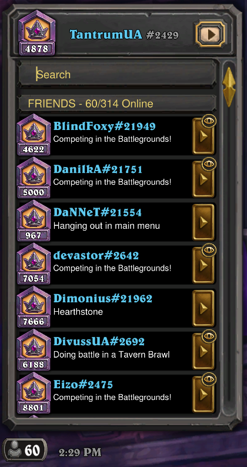
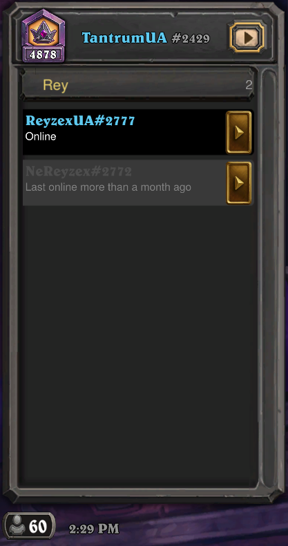
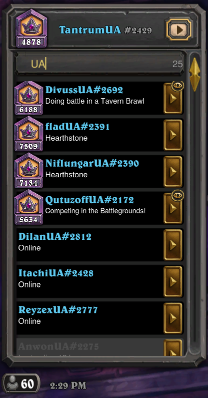

# HS Friend Search

A search bar for Hearthstone's friends list. Open the list, type part of a name, and only the matching
friends stay.

  
  
  

- The bar sits under your own name, styled like the list's own headers, and is ready to type in as soon as
  the list opens.
- Finds a name from any part of it: `ussua` finds DivussUA. Names that start with what you typed come first.
- Forgives typos once you've typed 4 letters or more (one wrong letter per 3 typed). Typo matches always come
  after the exact ones.
- Searches friends, friend requests and recent players, and finds BattleTag numbers too (`#2692`).
- Shows how many friends match on the right end of the bar.
- **Esc** clears the search; with the bar empty, Esc works as usual. Closing the list clears it as well.

## Install

1. Download `HSFriendSearch-Setup-<version>.exe` from [Releases](../../releases).
2. Close Hearthstone and run the setup. It finds your Hearthstone folder; check it and click Install.
3. Start Hearthstone from Battle.net as usual.

The setup brings [BepInEx](https://github.com/BepInEx/BepInEx), the mod loader, if your Hearthstone doesn't
have it yet. If it's already there (from another mod), it's left as it is.

**Requirements:** Windows, Hearthstone for PC (made for patch 36.6).

## Uninstall

Windows Settings → Apps → HS Friend Search → Uninstall (or the Start menu entry). BepInEx is removed too, unless
another mod still uses it or it was there before.

## Troubleshooting

- No search bar: check that `BepInEx\LogOutput.log` in your Hearthstone folder contains `HS Friend Search loaded`.
- After a Hearthstone patch the mod can stop working until it's updated.

Client mods are against Blizzard's terms of use; use it at your own risk. The mod changes only how your own
friends list is shown, and sends nothing anywhere.

## Credits

- [BepInEx](https://github.com/BepInEx/BepInEx), [HarmonyX](https://github.com/BepInEx/HarmonyX) and
  [Unity Doorstop](https://github.com/NeighTools/UnityDoorstop). Their licenses come with the setup.
- Built with [Claude Code](https://claude.com/claude-code) (Claude Opus 5.5), directed and tested by RTantrumR.
- The bar's art, fonts and text are Hearthstone's own, loaded from your installation.

## License

Copyright (c) 2026 RTantrumR. All rights reserved; see [LICENSE](LICENSE). Not affiliated with or endorsed by
Blizzard Entertainment. Hearthstone is a trademark of Blizzard Entertainment, Inc.
